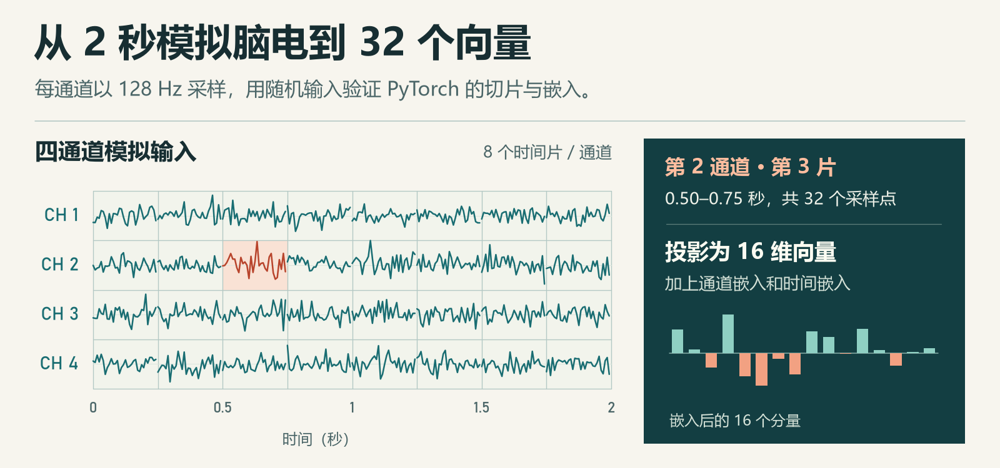

# 机器学习与数据分析手记

一段脑电信号和一句中文，各自怎样变成模型能读的数字？这是我自学脑机接口和语言模型时，动手实现的两个小实验。这个仓库还收录了我用中文影评练习 PyTorch 训练、比较两种分类器，以及用 pandas 追查销售额变化的过程。

[看脑电切片的实现](eeg-patches/eeg_patches.py#L31)　·　[看 BPE 怎样学会合并](bpe-tokenizer/tokenizer.py#L104)　·　[打开订单分析笔记](sales-analysis/sales_analysis.ipynb)

[](eeg-patches/eeg_patches.py#L31)

图里高亮的是第 2 通道从 0.50 秒开始的 32 个采样点。所有片段都经过同一个线性层，即使两个片段的波形一样，模型也能通过额外加上的嵌入区分它们来自哪个通道、哪个时段。四个通道各切八片，每条样本就得到 **32 个 16 维向量**。[运行 EEG 示例](eeg-patches/README.md)

## 一个空格，分词器会怎么处理？

用仓库里的小语料训练后，`ab ab` 从 5 个 UTF-8 字节变成了 2 个 token。中间的空格保留在第二个 token 里。

| | 第一个 token | 第二个 token |
| --- | --- | --- |
| 包含的文本 | `ab` | 一个空格加上 `ab` |
| 初始字节 | `97, 98` | `32, 97, 98` |
| 合并后的 ID | `258` | `259` |

数字取决于这次训练学到的合并顺序。脚本还用带中文、连续空格和换行的文本检查解码结果是否逐字还原，并验证 `<|pad|>` 始终是一个 token。[看编码实现](bpe-tokenizer/tokenizer.py#L179) · [运行 BPE 示例](bpe-tokenizer/README.md)

## 训练完，怎么检查模型？

**中文短句情感分类 · PyTorch**  
用「电影 很 精彩」等 8 条短句训练词嵌入和线性层，再用「电影 很 好看」等 4 条重新组合的短句做验证。最后把词表和模型参数一起保存，重新加载，对同一批输入逐项核对预测概率和类别。[看训练脚本](pytorch-classifier/sentence_classifier.py) · [看重载后的两个断言](pytorch-classifier/sentence_classifier.py#L200)

**表格数据二分类 · TensorFlow**  
在 Wisconsin 乳腺癌公开数据集上，我用同一批样本比较逻辑回归和两层全连接网络。这次固定划分的测试集有 86 条记录，32 条属于正类。逻辑回归漏判了 1 条，全连接网络漏判了 2 条。笔记还挑出一条误判记录，拆开看各项特征怎样影响了逻辑回归的判断。[打开分类实验](tabular-classification/classification.ipynb) · [看数据划分和指标](tabular-classification/README.md)

## 少掉的 1,000 元销售额去了哪里？

用 pandas 清洗 18 笔模拟订单，再把六月和七月的实付金额按渠道拆开。订单总额少了 1,000 元，变化全部出现在官网。

| 渠道 | 六月 | 七月 | 变化 |
| --- | ---: | ---: | ---: |
| 官网 | 1,650 元 | 650 元 | −1,000 元 |
| 平台 | 950 元 | 950 元 | 0 元 |

再按商品看，官网的咖啡壶从 900 元降到了 0 元。要分辨是缺货、下架还是访问量变化，还需要商品上架记录和流量数据。[打开含图表与明细的订单分析](sales-analysis/sales_analysis.ipynb)

<details>
<summary>在本地跑第一个示例</summary>

从仓库根目录执行以下命令，即可看到分词结果和编解码检查。训练语料随脚本提供。

```sh
python -m pip install regex
python bpe-tokenizer/tokenizer.py
```

其他实验各自列出了依赖和运行方法。[脑电切片](eeg-patches/README.md) · [中文短句分类](pytorch-classifier/README.md) · [表格数据二分类](tabular-classification/README.md) · [订单分析](sales-analysis/README.md)

</details>
