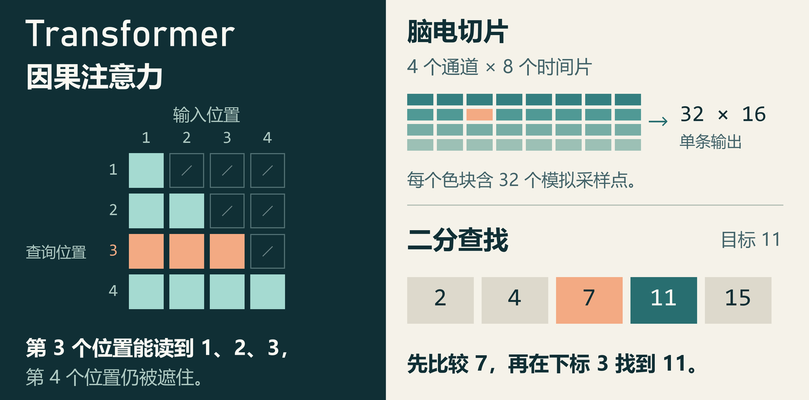

# Transformer、脑电信号与算法实现

输入三个 token，一个两层语言模型怎样选出第四个？把输入换成四通道脑电，注意力又该看哪些位置？这里收录了我学习 CS336、脑电信号处理和数据结构时整理的代码。可以从下面三个入口直接看模型、频谱和算法。

**[读两层 Transformer](cs336-transformer/model.py#L60)**　·　**[打开脑电频谱实验](eeg-signal-lab/frequency-and-phase.ipynb)**　·　**[看二分如何分割数组](algorithms/binary_search.py#L135)**



## 从字节到下一个 token

字节级 BPE 先解决输入问题。用仓库里的小语料训练后，`ab ab` 的五个字节变成 `[258, 259]`，第二个 token 连同空格一起编码。解码时，中英文、连续空格和换行都要能逐字还原。[分词器源码](bpe-tokenizer/tokenizer.py#L104) · [CS336 基础实验](cs336-foundations/README.md)

`TinyTransformerLM` 接收 token ID，经词嵌入、带 RoPE 的多头因果注意力、RMSNorm 和 SwiGLU，最后为每个位置输出 260 个候选分数。改掉输入序列末尾的一个 token，可以直接检验前面位置的输出是否保持一致。[分步运行注意力实验](cs336-transformer/walkthrough.ipynb) · [查看模型结构](cs336-transformer/model.py#L60)

这个模型有 **2 层、2 个注意力头、5,480 个可训练参数**。在两条合成序列上做一次 SGD 更新，同一批输入的交叉熵由 **5.5791 降到 5.4766**。生成时从 `[10, 20, 30]` 出发，每次追加当前得分最高的 ID，再计算下一步。[训练与贪心生成](cs336-transformer/demo.py) · [参数量与计算量估算](cs336-transformer/architecture.py)

## 从模拟脑电到频谱与分类

下图高亮了第二通道的一个时间片。每个通道以 128 Hz 采样，32 个点刚好是四分之一秒。每片经过共享的线性投影，再加上通道和时间嵌入，一条两秒的四通道样本就得到 **32 个 16 维向量**。

[](eeg-patches/eeg_patches.py#L31)

语言模型预测下一个 token 时要遮住未来位置。给整段 EEG 做分类时，一个时间片可以读取同一窗口里的其他片段。分类器用双向 Transformer 编码这些片段，再沿时间片与通道组成的序列取平均。两条随机样本最终输出形状为 `[2, 3]` 的三类分数。[分类器源码](eeg-patches/classifier.py) · [比较两种切片方式](eeg-patches/README.md)

信号处理笔记从采样和量化开始，接着观察移动平均与延迟反馈。最后把信号投影到复指数基上，手算 DFT，对照 NumPy 的 FFT，再用逆变换还原输入。[采样与量化](eeg-signal-lab/sampling-and-quantization.ipynb) · [从投影到 DFT](eeg-signal-lab/projection-to-dft.ipynb) · [全部信号实验](eeg-signal-lab/README.md)

## 数据结构与算法

把 `[7, 2, 5, 10, 8]` 切成两段，怎样让较大一段的和尽可能小？把上限设为 17 时要分三段；上限放宽到 18 时，`[7, 2, 5]` 和 `[10, 8]` 就能满足条件。这份实现对**可行的上限**做二分。相同思路还可以用来求最小运载能力。[查看二分实现](algorithms/binary_search.py#L135)

| 想看什么 | 实现入口 |
| --- | --- |
| 数组怎样扩容、原地去重，窗口何时收缩 | [动态数组](algorithms/dynamic_array.py) · [双指针](algorithms/two_pointers.py) · [滑动窗口](algorithms/sliding_window.py) |
| 怎样快速算区间和，或批量更新一个区间 | [一维和二维前缀和](algorithms/prefix_sum.py) · [差分数组](algorithms/difference_array.py) |
| 怎样只保留一行编辑距离状态，或按局部选择求解 | [动态规划](algorithms/dynamic_programming.py) · [贪心算法](algorithms/greedy.py) |
| 怎样逐步观察栈、队列、排序与回溯 | [交互图解和运行方法](algorithms/README.md#逐步观察算法) |

[浏览全部算法与边界样例](algorithms/README.md)

## 分类与数据分析

- **中文短句分类。** 用 8 条短句训练词嵌入和分类层，在 4 条重新组合的短句上验证。保存并重载词表和参数后，逐项核对概率与类别。[PyTorch 实现](pytorch-classifier/sentence_classifier.py)
- **表格二分类。** 在同一组 86 条测试记录上比较逻辑回归和两层全连接网络。这次固定划分有 32 条正类，两种模型分别漏判 1 条和 2 条。笔记中还拆解了一条误判记录的特征贡献。[TensorFlow 实验](tabular-classification/classification.ipynb)
- **电商订单分析。** 18 笔模拟订单的月销售额从 2,600 元降到 1,600 元。按渠道拆开，平台两月均为 950 元；再按商品拆分，官网咖啡壶一项减少了 900 元。[pandas 分析与图表](sales-analysis/sales_analysis.ipynb)

<details>
<summary>在本地运行 Transformer</summary>

从仓库根目录运行。模型与合成输入均由脚本创建，CPU 即可复现实验。

```sh
python -m pip install torch
python cs336-transformer/demo.py
```

</details>
